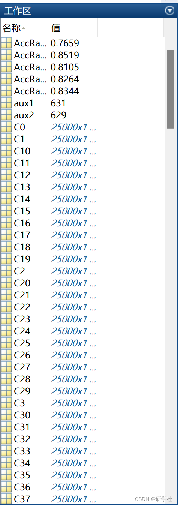

# Invasive Load Monitoring Based on KPCA and STFT (Matlab Code Implementation)

​  
📚2 Running Results Editing
Part of the code:
%% Classification  
%% KNN  
% Train  
start_time_train=cputime;  
KNN = fitcknn(Xtrainp,Ytrain,'NumNeighbors',5);  
end_time_train=cputime;  
TrainTime_knn=end_time_train-start_time_train  
% Test  
start_time_test=cputime;  
label_knn = predict(KNN,Xtestp);  
end_time_test=cputime;  
TestTime_knn=end_time_test-start_time_test  
AccRate_Knn = sum(Ytest' == label_knn)/length(Ytest)  
%% SVM  
% Train  
start_time_train=cputime;  
tSVM = templateSVM('Standardize',1,'KernelFunction','linear');  
SVM = fitcecoc(Xtrainp,Ytrain,'Learners',tSVM);  
end_time_train=cputime;  
TrainTime_svm=end_time_train-start_time_train  
% Test  
start_time_test=cputime;  
label_svm = predict(SVM,Xtestp);  
end_time_test=cputime;  
TestTime_svm=end_time_test-start_time_test  
AccRat_svm = sum(Ytest' == label_svm)/length(Ytest)  
%% LDA  
% Train  
start_time_train=cputime;  
LDA = fitcdiscr(Xtrainp,Ytrain);  
end_time_train=cputime;  
TrainTime_lda=end_time_train-start_time_train  
% Test  
start_time_test=cputime;  
label_lda = predict(LDA,Xtestp);  
end_time_test=cputime;  
TestTime_lda=end_time_test-start_time_test  
AccRate_lda = sum(Ytest' == label_lda)/length(Ytest)  
%% Decision tree  
% train  
start_time_train=cputime;  
TREE = TreeBagger(150,Xtrainp,Ytrain,'OOBPredictorImportance','on');  
end_time_train=cputime;  
TrainTime_tree=end_time_train-start_time_train  
% Test  
start_time_test=cputime;  
label_tree = str2double(predict(TREE,Xtestp));  
end_time_test=cputime;  
TestTime_tree=end_time_test-start_time_test  
AccRate_tree = sum(Ytest' == label_tree)/length(Ytest)  
%% ELM  
[TrainingTime, TestingTime, ~, AccRate_elm, label_elm] = elm_aece(Xtrainp',...  
Ytrain, Xtestp', Ytest, 1, 1500, 'sig');  
AccRate_elm  
%% Statistics  
C_svm = confusionmat(Ytest',label_svm);  
C_lda = confusionmat(Ytest',label_lda);  
C_knn = confusionmat(Ytest',label_knn);  
C_tree = confusionmat(Ytest',label_tree);  
C_elm = confusionmat(Ytest',label_elm);  
[result_svm,reference_svm]= getStatistical(C_svm);  
[result_knn,reference_knn]= getStatistical(C_knn);  
[result_lda,reference_lda]= getStatistical(C_lda);  
[result_tree,reference_tree]= getStatistical(C_tree);  
[result_elm,reference_elm]= getStatistical(C_elm);  
🎉3 References
[2]Daniel Cavalieri (2022). KPCA and STFT Non-intrusive Load Monitoring  
🌈4 Matlab code implementation

## Images

<!-- PAYMENT_BLOCK -->

## Get this dataset

- Payment link (Stripe): [Buy now](https://buy.stripe.com/3cs8yP7sY87d0vu9AB)
- Payment QR code: 

<!-- /PAYMENT_BLOCK -->
